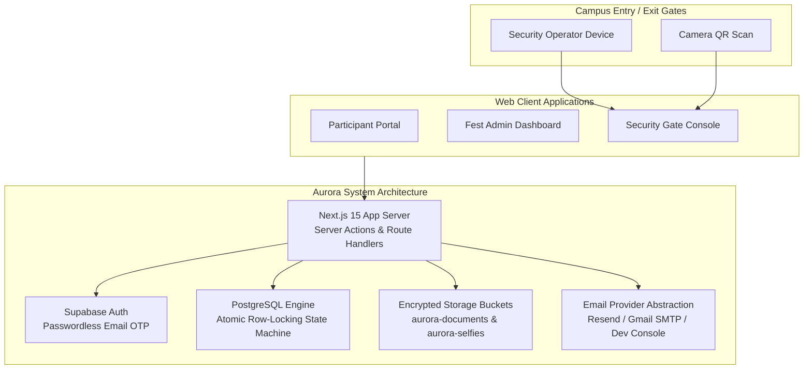

# Aurora — Architecture & Technology Stack
## Kaltarang 2026 External Participant Identity & Access System

---

## 1. System Context & Overview

Aurora replaces physical paperwork and spreadsheet-based documentation at Kaltarang 2026 entry/exit gates with a centralized, auditable digital identity system.

---

## 2. Component Design & Roles

### 1. Participant Portal (`/portal`)
- Multi-step registration wizard (Identity confirmation, personal details, WebRTC live camera photograph, Student ID & Aadhaar uploads, event selection).
- Active access pass display with high-resolution QR rendering and current campus state (`INSIDE` vs `OUTSIDE`).

### 2. Admin Dashboard (`/admin`)
- Payment-verified invitation generator with SHA-256 token hashing.
- Verification Desk: side-by-side dossier review, photo comparison, and one-click approval / correction request / rejection.
- Live campus occupancy tracking and gate-by-gate activity stream.
- Privacy-compliant CSV reporting (Aadhaar excluded).

### 3. Gate Security Console (`/security`)
- High-contrast, mobile-first gate console.
- WebRTC camera QR scanner.
- Instant validation screen displaying registered selfie for visual match.
- Atomic `ALLOW ENTRY` and `ALLOW EXIT` operations enforcing strict state machine transitions and blocking duplicate pass reuse.
- Supervisor manual PIN override.

---

## 3. Technology Stack

- **Framework**: Next.js 15 with App Router, TypeScript, React 19
- **Design System & Styling**: Tailwind CSS v4 with custom `oklch` festival color palette and Radix UI / shadcn components
- **Typography**: `Instrument Serif` (display branding) & `Work Sans` (interface body)
- **Database**: PostgreSQL 15+ via Supabase with Row Level Security (RLS)
- **Storage**: Supabase Private Storage Buckets
- **Email Service**: Resend (Free Tier) / Gmail SMTP (Free Tier via Nodemailer) / Dev In-Memory Outbox
- **QR Engine**: Server-rendered QR code (`qrcode`) with HMAC-SHA256 signature
